# Klastay — engineering case study

How I build and run [Klastay](https://klastay.com), a vacation-rental marketplace for Morocco, as its co-founder and CTO — lead engineer of the web platform and sole developer of the Flutter app — using several AI coding agents in parallel instead of a team.

This repository is documentation, not source code. The Klastay codebase is private; everything here is written from the real repositories, their pull requests and their release history, without exposing code, credentials or user data.

> **Status (November 2026):** web platform live at klastay.com, Android app in Google Play review, iOS app in App Store review. Hosts are onboarding first; bookings and payments open after.

---

## 1. Overview

Klastay lets travellers rent riads, villas and apartments in Morocco and **negotiate the price directly with the host**, instead of only accepting a listed price. Three ideas drive the product:

- **Offers and counter-offers** — a traveller proposes a nightly price; the host accepts, refuses or counters within a 24-hour negotiation window.
- **Live Search** — the traveller publishes dates, budget and a radius around them; nearby hosts answer with offers in real time.
- **Stay Together** — families or groups book several homes close to each other in one transaction.

Since June 2026 I have owned the mobile app end to end (iOS and Android) and led the web platform: architecture, backend and PostgreSQL data model, authentication, the internal CRM, third-party integrations, testing, deployments and store releases — coordinating the other contributors (see [My role](#8-my-role)).

## 2. Product screenshots

All screenshots are of the real product. Web captures were taken signed-out from the live site; host-mode mobile screens are rendered from the Flutter app with test data (the names in them are fictitious).

| Web — explore | Web — listing with *Make an offer* |
|---|---|
| 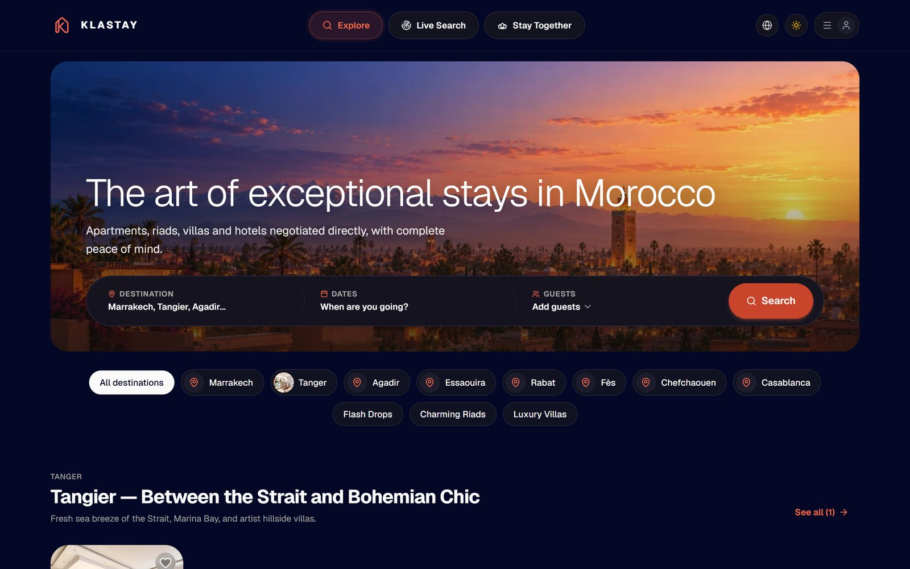 | 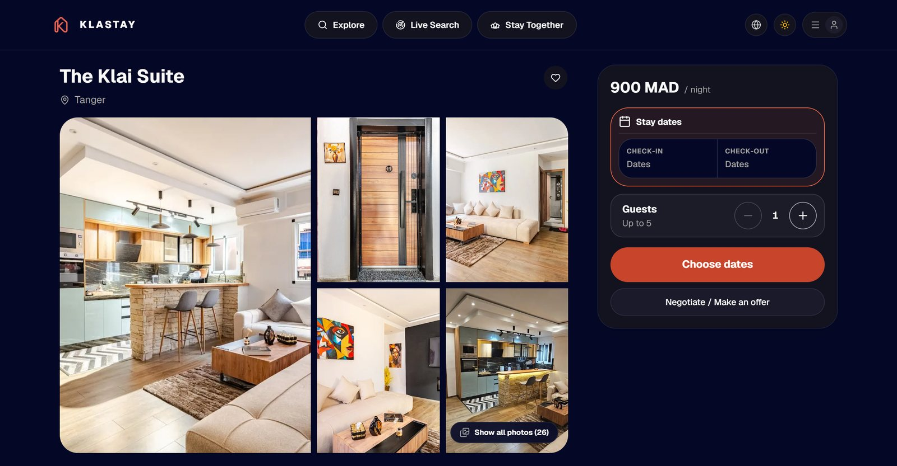 |
| **Web — Live Search** | **Web — Stay Together** |
| 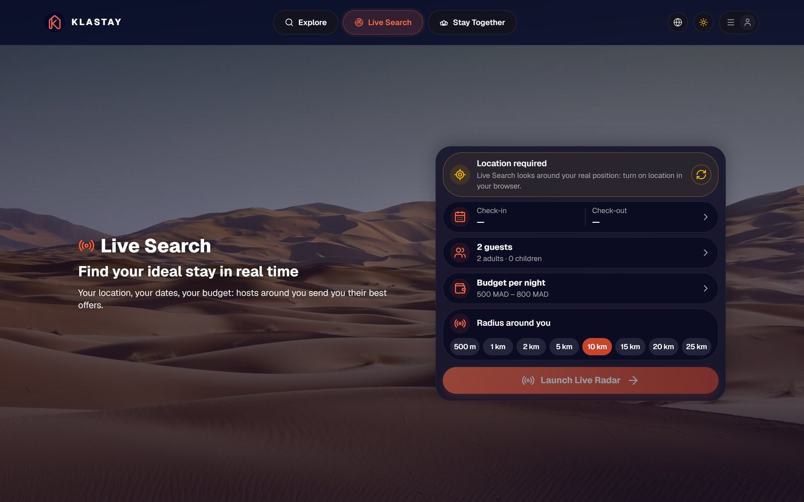 | 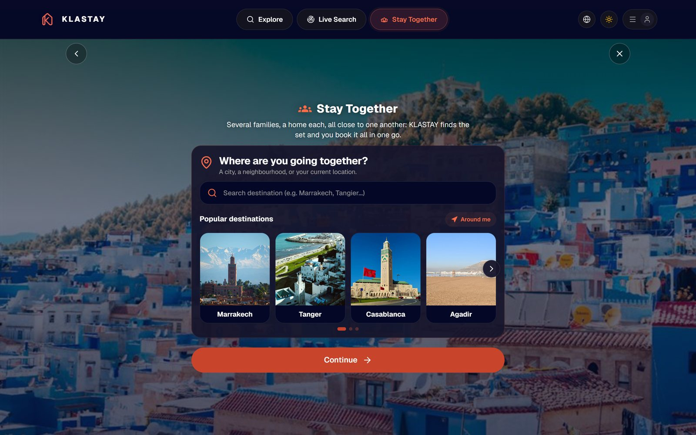 |

| Android — explore | Android — approximate location | iOS host — offer received | iOS host — counter-offer | iOS host — Live Search request |
|---|---|---|---|---|
| 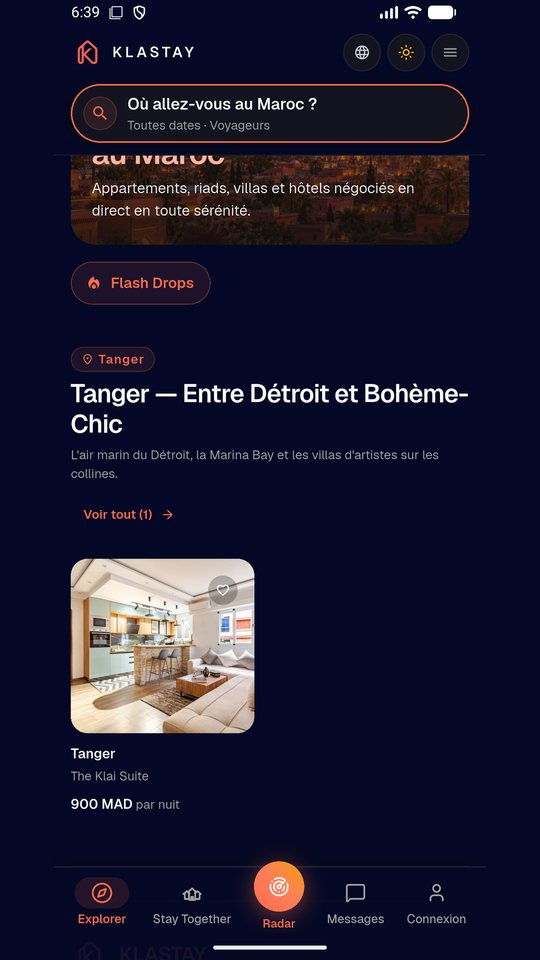 | 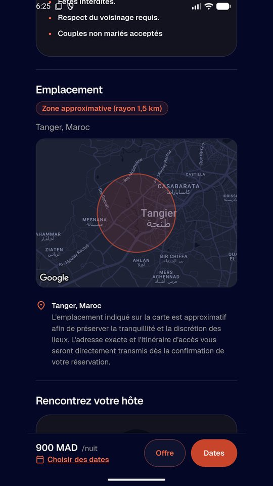 | 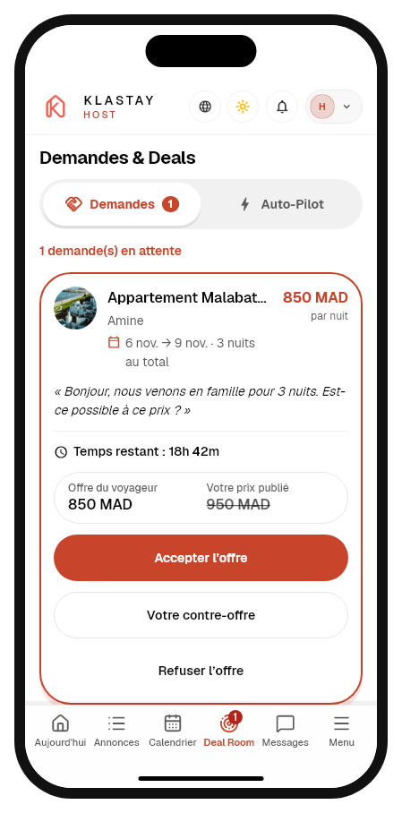 | 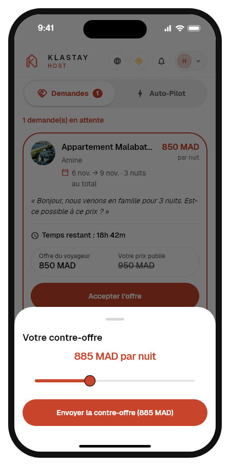 | 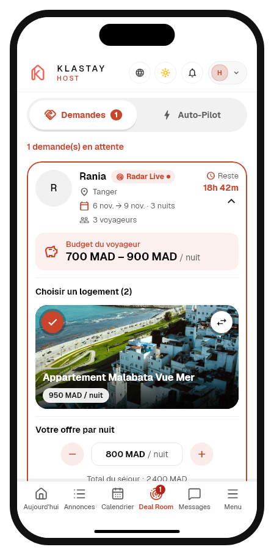 |

## 3. Architecture

Business rules live in **PostgreSQL** (Supabase): row-level security, a booking/negotiation state machine, and RPC functions for quoting and booking. The web app, the mobile apps and the CRM are clients of the same database and the same API — the mobile app does not re-implement pricing or availability.

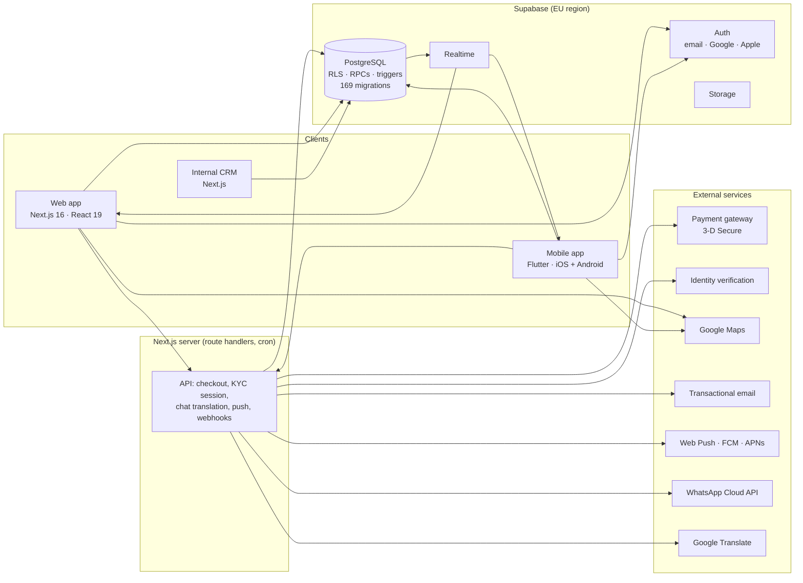

More detail — invariants, environments, hosting and the mobile package structure — in [docs/architecture.md](docs/architecture.md).

## 4. Agentic development workflow

I ran **up to four AI coding agents in parallel** (mainly Claude Code, sometimes OpenAI Codex), each on its own feature branch and usually in its own **git worktree**, so agents never shared a working directory. Integration, testing and promotion to production stayed with me.

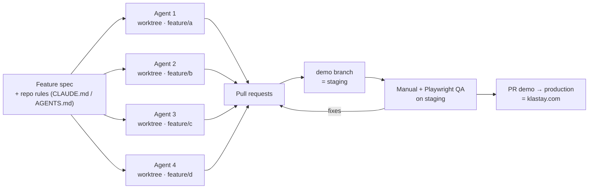

In numbers, from the repositories: the web repo has **329 pull requests** — 276 into `demo` and **53 merged into `production`**, of which 37 are `demo → production` promotions and 16 are targeted production fixes. The web and mobile repos currently have **40 linked git worktrees** between them, one per feature stream or agent.

How I split work, wrote the instructions agents follow, reviewed their output and kept unvalidated changes out of production: [docs/agentic-workflow.md](docs/agentic-workflow.md).

## 5. Quality assurance and releases

- **Automated tests.** Flutter app: 1,000+ unit, widget and bloc tests across the app and 12 local packages, checked with `flutter analyze` and `very_good_analysis` before asking for review (a rule in the repository instructions), plus a GitHub Actions workflow with an 80 % coverage gate. Web: Node test suites for the cancellation engine, emails, push, WhatsApp verification, host onboarding and CRM refunds, including integration tests against the staging database.
- **End-to-end checks with Playwright** against staging: authentication (sign-up, email confirmation, password reset), WhatsApp OTP verification, live offers, booking and cancellation, checkout, chat translation, CRM login guard and session revocation, and authorisation checks such as IDOR and horizontal-access probes.
- **Two environments.** Separate staging and production databases and deployments. Nothing reaches production without passing through staging; schema changes are always a new numbered migration, applied to staging first.
- **Mobile releases.** Codemagic builds signed iOS and Android artifacts per flavour (dev → staging backend, prod → production). **91 iOS builds** went through TestFlight (I ran the build, test and release process; some uploads were made from my co-founder's machine and account); Android builds went to Play internal testing before production. I handled App Store Connect and Play Console setup, store listings, data-safety forms and review answers.

Details: [docs/quality-and-releases.md](docs/quality-and-releases.md).

## 6. Technical challenges

A few real problems and how they were solved (full write-ups in [docs/technical-challenges.md](docs/technical-challenges.md)):

1. **A mobile client on a cookie-authenticated API** — added bearer-token support to the server routes the app needs, without changing behaviour for the web.
2. **Hosts stuck in a loop after publishing** — traced to database rules that keep a listing hidden until identity check and host charter are complete; rebuilt the onboarding around a single server-side access check.
3. **Native push from scratch** — FCM HTTP v1 sending with service-account JWT signing and a device-token table, alongside existing Web Push.
4. **Payments that cannot misfire** — production refuses to charge unless real gateway keys are configured, enforced by a test.
5. **Privacy by design** — other users' contact details are not readable through RLS; contact data is released only for a paid booking, and listing maps show an approximate zone.
6. **App Store requirements for user-generated content** — reporting, two-way blocking and in-app account deletion across web, database and app.

## 7. Technologies

Only what Klastay actually uses.

| Area | Stack |
|---|---|
| Web | TypeScript, Next.js 16 (App Router), React 19, Tailwind CSS, shadcn/ui |
| Mobile | Flutter / Dart, Bloc, go_router, layered packages (API client, 11 repositories, UI kit) |
| Backend & data | Supabase: PostgreSQL (RLS, PL/pgSQL RPCs, triggers), Auth, Storage, Realtime; Next.js route handlers and cron jobs |
| Integrations | card payments (3-D Secure gateway), identity verification (KYC), Google Maps, Google & Apple sign-in, FCM/APNs, Web Push, WhatsApp Cloud API, Google Translate, iCal sync, transactional email |
| Testing | flutter_test, bloc_test, mocktail, Node test runner (tsx), Playwright |
| Delivery | Git branches + worktrees, GitHub pull requests, GitHub Actions, Codemagic, Docker-based self-hosting, TestFlight, App Store Connect, Google Play Console |
| AI tooling | Claude Code (parallel sessions, sub-agents in isolated worktrees, repo instruction files, skills), OpenAI Codex |

## 8. My role

- **Scope:** lead engineer of the web platform and sole developer of the Flutter app.
- **Personally:** product and technical decisions, architecture and data model, the split of work into agent-sized tasks, the instruction files and invariants agents follow, reviewing agent output (most closely where it touches auth, data, money or privacy), integration, QA on staging, production deploys, database migrations to production, mobile signing and store releases, and incident fixing.
- **With AI agents:** most of the code was written by agents working under those instructions, on separate branches, and then reviewed, corrected and integrated by me. I treat agent output like a pull request from a fast junior engineer: useful, but my rule is not to integrate it before reading it and seeing it run.
- **Other contributors:** my co-founder made changes to the web and mobile code — mostly UI and design adjustments and production fixes — and an external developer built the payment-gateway integration (checkout, escrow and payouts). I set the conventions they worked within and integrated their changes with the rest of the platform.

## 9. Private source code

Klastay is a commercial product and its source code is private. I am happy to walk through the architecture, show the running product (web, iOS and Android) and discuss specific pull requests, migrations or design decisions in an interview.

---

Mohamed El Mhamdi · [LinkedIn](https://www.linkedin.com/in/mohamed-el-mhamdi-8b889824b) · [klastay.com](https://klastay.com)
