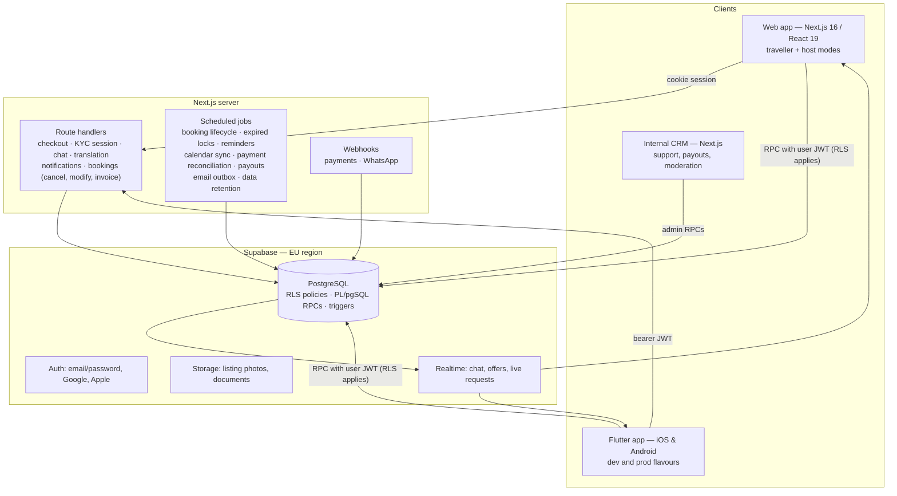

# Architecture

## Principle: one source of truth

The database is the product's core. Pricing, availability, the booking and negotiation state machine, and access rules live in PostgreSQL (Supabase) as RPC functions, triggers and row-level security policies. The web app, the Flutter app and the internal CRM are all clients of that core. A mobile screen showing a price shows what the server quoted; it never computes or sends an amount the server would trust.

## Components



### Booking and negotiation

- 10 canonical statuses: `inquiry`, `host_pending`, `guest_pending`, `confirmed`, `active`, `completed`, `dates_lost`, `cancelled`, `declined`, `expired`.
- Offers and counter-offers run inside a 24-hour window, after which they expire automatically.
- Double bookings are prevented in the database: booking creation is transactional, and competing requests for the same dates move to `dates_lost` when another guest pays first.
- Quotes (`quote booking`, `quote offer`) are RPCs; the commission (10 %) and currency (MAD) are applied server-side.

### Authentication and privacy

- Supabase Auth with email/password, Google and Sign in with Apple; users must confirm they are 18 or older at sign-up.
- Row-level security on every user-facing table. Another user's email, phone and bank details cannot be selected directly: a user reads their own profile through an RPC, and the counterpart's contact details become available only for a paid booking, through a dedicated RPC.
- Listing maps show an approximate zone; exact address and access instructions are released only after a confirmed booking.
- All data is stored in EU infrastructure (Moroccan law 09-08 and GDPR).

### Mobile app structure

Layered Flutter architecture:

```text
lib/                     feature folders (explore, listing_detail, make_offer, live_search,
                         stay_together, checkout, trips, messages, host/*, profile, ...)
                         presentation + Bloc/Cubit per feature, go_router navigation
packages/
  klastay_api_client     Supabase RPC + HTTP client, DTOs
  *_repository (11)      auth, listing, booking, chat, host, profile, notification,
                         stay_together, support, launch, ...
  klastay_ui             design tokens and shared widgets (Material 3 + Cupertino behaviours)
```

Seven languages (French by default, English, Spanish, German, Arabic with full RTL, Italian, Dutch), light and dark themes, session stored in the platform keystore.

### Integrations

| Service | Used for | Where it runs |
|---|---|---|
| Payment gateway | card payments with 3-D Secure, escrow and host payouts | server only |
| Identity-verification provider | identity verification for hosts | session created by the server; user completes it in a browser tab |
| Google Maps | maps, address search | web + app (restricted keys) |
| Google / Apple sign-in | authentication | Supabase Auth |
| FCM, APNs, Web Push | notifications | sent by the server; device tokens stored per user |
| WhatsApp Cloud API | host phone verification | server webhook |
| Google Translate | chat message translation | server only |
| iCal | calendar sync with other platforms | server |
| Transactional email | confirmations, reminders, support | server, with an outbox table |

### Environments and hosting

| | Staging | Production |
|---|---|---|
| Database | separate Supabase project, seed data | Supabase project, real data |
| Web + CRM | Docker containers on a self-managed server | same, separate apps |
| Mobile | `development` flavour (staging backend) | `production` flavour |
| Git branch | `demo` | `production` |

Mobile builds are produced by Codemagic (signed iOS IPA to TestFlight, Android AAB/APK); the Flutter repository also runs GitHub Actions (lint, tests, coverage gate, license check).
